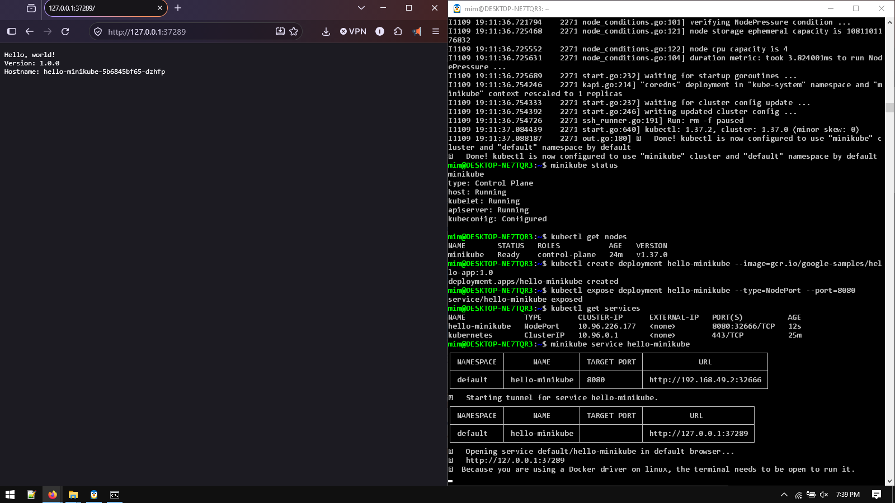
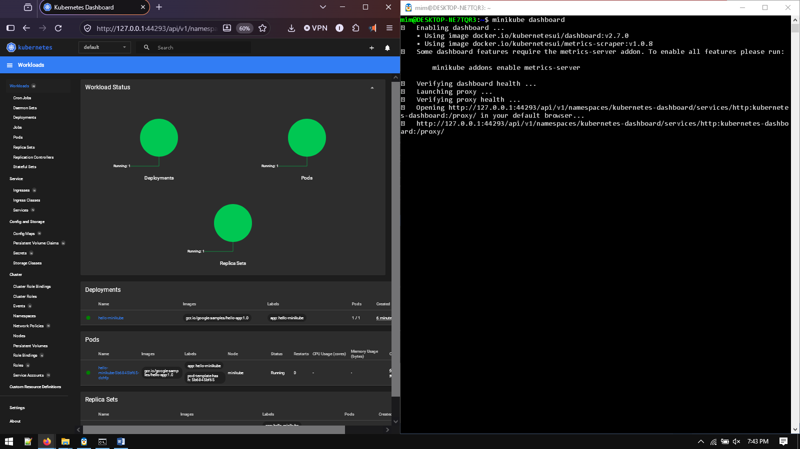
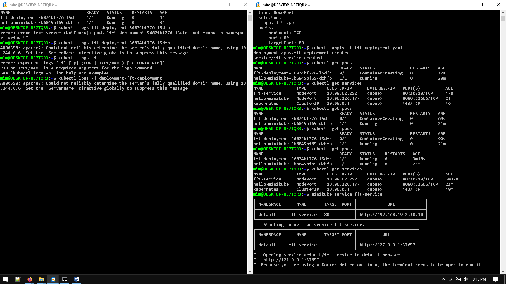
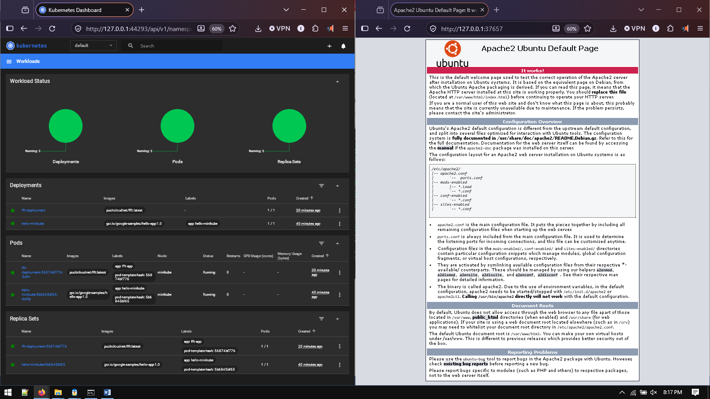
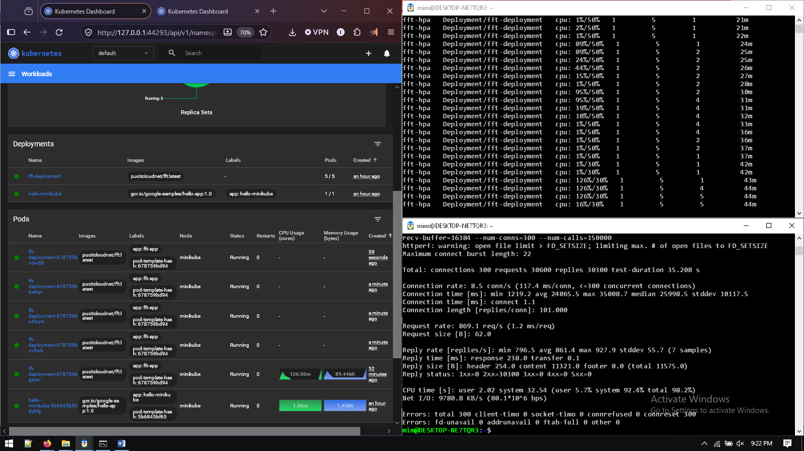
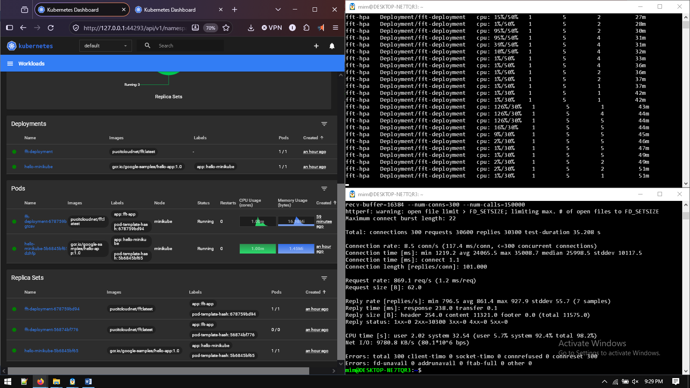
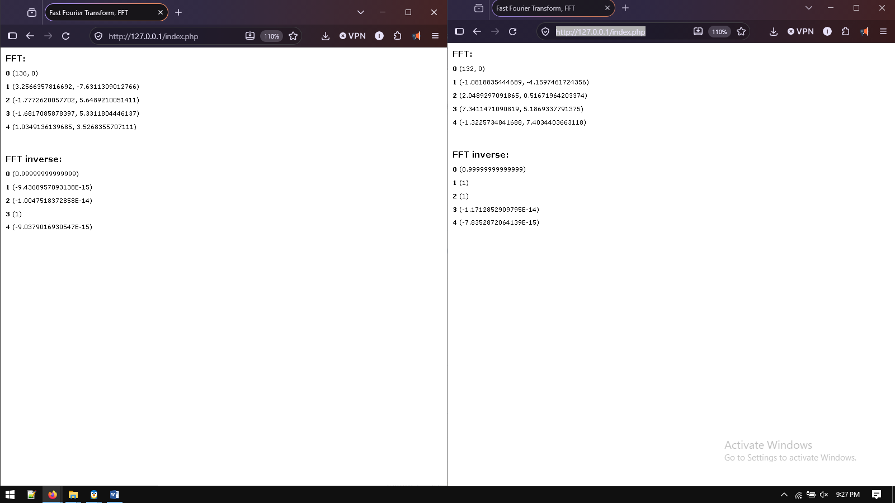

# FFT Function Deployment & Autoscaling over Kubernetes (Minikube)

[](https://kubernetes.io/)
[](https://minikube.sigs.k8s.io/)
[](https://www.docker.com/)
[](https://ubuntu.com/)
[](https://kubernetes.io/docs/tasks/run-application/horizontal-pod-autoscale/)
[](LICENSE)

A production-grade demonstration of containerized **Fast Fourier Transform (FFT)** application deployment, declarative service routing via **Kubernetes LoadBalancer**, and dynamic elasticity via **Horizontal Pod Autoscaler (HPA v2)** using Minikube on WSL2 (Ubuntu). Evaluated and benchmarked under synthetic high-concurrency workloads using **httperf**.

---

## 📋 Table of Contents
- [Executive Summary](#-executive-summary)
- [Key Engineering & Academic Highlights](#-key-engineering--academic-highlights)
- [System Architecture & Elasticity Flow](#-system-architecture--elasticity-flow)
- [Core Competencies & Skills Demonstrated](#-core-competencies--skills-demonstrated)
- [Repository Structure](#-repository-structure)
- [Prerequisites & Environment Setup](#-prerequisites--environment-setup)
- [Milestone Breakdown](#-milestone-breakdown)
  - [Milestone 01: Kubernetes Infrastructure & Cluster Initialization](#milestone-01-kubernetes-infrastructure--cluster-initialization)
  - [Milestone 02: Declarative Deployment & Service Networking](#milestone-02-declarative-deployment--service-networking)
  - [Milestone 03: Dynamic Autoscaling (HPA) & Synthetic Stress Benchmarking](#milestone-03-dynamic-autoscaling-hpa--synthetic-stress-benchmarking)
- [Quickstart & Reproduction Guide](#-quickstart--reproduction-guide)
- [Empirical Results & Screenshot Evidence](#-empirical-results--screenshot-evidence)
- [Academic & Course Attribution](#-academic--course-attribution)

---

## 🚀 Executive Summary

Modern cloud architectures demand high elasticity, resilience, and optimal resource utilization under bursty workloads. This project demonstrates an end-to-end container orchestration pipeline:
1. **Infrastructure Provisioning**: Single-node Kubernetes development cluster provisioned via **Minikube** with containerized Docker driver.
2. **Declarative Microservice Packaging**: Containerized Apache/PHP application performing computationally intensive Fast Fourier Transform (FFT) algorithms (`pucitcloudnet/fft:latest`).
3. **Traffic Ingress & Load Balancing**: Implementation of a Kubernetes `LoadBalancer` service routed into host networking using `minikube tunnel`.
4. **Automated Elasticity (HPA)**: Closed-loop autoscaling controller dynamically adjusting pod replicas (from $1 \to 5$ instances) based on real-time CPU metric telemetry, validated with high-rate load generation via **httperf**.

---

## 🌟 Key Engineering & Academic Highlights

- **Predictable Resource Allocation**: Configured precise `requests` (`100m` CPU, `128Mi` RAM) and `limits` (`250m` CPU, `256Mi` RAM) to guarantee Quality of Service (QoS: *Burstable*) and prevent resource starvation.
- **Closed-Loop Horizontal Autoscaling**: Integrated Kubernetes `metrics-server` telemetry feeding into `HorizontalPodAutoscaler` with a 50% average CPU utilization threshold.
- **Performance & Stress Benchmarking**: Automated concurrency stress tests simulating 300 connections at a throughput of 1500 req/sec via `httperf` to trigger scale-out and analyze subsequent scale-in cooldown.
- **Reproducible Infrastructure as Code (IaC)**: Pure declarative Kubernetes YAML manifests ensuring seamless deployment across any standard Kubernetes cluster (Minikube, Kind, K3s, EKS, GKE, AKS).

---

## 🏗 System Architecture & Elasticity Flow

```
                                  +---------------------------------------+
                                  |            httperf Client             |
                                  | (High-Throughput Synthetic Workload)  |
                                  +-------------------+-------------------+
                                                      |
                                                      v  HTTP (127.0.0.1:80)
                                  +---------------------------------------+
                                  |            minikube tunnel            |
                                  +-------------------+-------------------+
                                                      |
                                                      v
                          +-------------------------------------------------------+
                          |        Kubernetes Service (Type: LoadBalancer)        |
                          |               Port: 80 -> TargetPort: 80              |
                          +---------------------------+---------------------------+
                                                      | Round-Robin Distribution
                               +----------------------+----------------------+
                               |                                             |
                               v                                             v
                  +-------------------------+                   +-------------------------+
                  |   Pod: fft-deployment   |  <==== HPA =====> |   Pod: fft-deployment   |
                  |  Image: pucitcloudnet/  |  (Target: 50% CPU)|  (Scale Out: 1 -> 5)    |
                  |        fft:latest       |                   |  (Scale In:  5 -> 1)    |
                  +-------------------------+                   +-------------------------+
```

---

## 💡 Core Competencies & Skills Demonstrated

| Domain | Demonstrated Competencies & Tools |
| :--- | :--- |
| **Container Orchestration** | Kubernetes (`Deployments`, `Services`, `HPA v2`, `Pods`, `Config`, `Metrics Server`) |
| **Local Cloud Infrastructure** | Minikube, Docker Engine, WSL2 (Ubuntu Linux), Container Networking |
| **Site Reliability & Performance** | Horizontal Elasticity, CPU Metrics Telemetry, Synthetic Stress Testing (`httperf`) |
| **Networking & Traffic Mgmt** | Layer 4/7 Ingress, `LoadBalancer`, `NodePort`, Local Routing via Network Tunneling |
| **Cloud Computing Theory** | Resource Isolation, QoS Classes, Reactive Autoscaling, Fast Fourier Transform (FFT) |

---

## 📁 Repository Structure

```
.
├── ccproj3/
│   ├── fft-deployment.yaml          # Declarative Deployment & NodePort manifest
│   ├── fft-hpa-lb.yaml              # Production manifest: Resource Limits, LoadBalancer, & HPA
│   ├── MSDSF25A007-cc-assgn3.docx   # Academic project report with comprehensive findings
│   ├── MSDSF25A007-cc-assgn3.zip    # Submission archive
│   ├── AwesomeScreenshot-*.mp4      # End-to-end execution & scaling video demonstration
│   └── revise/
│       ├── chronological_commands_reference.md  # Step-by-step CLI execution ledger
│       ├── milestones_summary.md                # Milestone completion summary
│       └── restart_guide.md                     # Cluster restart & disaster recovery manual
├── screenshots/
│   ├── 01_minikube_terminal_setup.png           # Cluster initialization & node health check
│   ├── 02_minikube_dashboard.png                # Minikube GUI dashboard overview
│   ├── 03_deployment_pods_services.png          # Active Pods and LoadBalancer service state
│   ├── 04_fft_application_ui_browser.png        # Interactive FFT web application in browser
│   ├── 05_hpa_max_replicas_scaling.png          # Scale-out under load to max replicas (5/5)
│   ├── 06_hpa_cooldown_min_replicas.png         # Scale-in cooldown back to baseline (1/1)
│   └── 07_fft_calculation_results_ui.png        # Mathematical verification of FFT & IFFT computation
├── Assignment_3__Deployment_on_Kubernetes_Fall_2026.pdf # Official course assignment prompt
└── README.md                                    # Project documentation and engineering manual
```

---

## ⚙ Prerequisites & Environment Setup

- **Host OS**: Windows 10/11 with **WSL2** (Ubuntu 22.04 LTS recommended)
- **Container Runtime**: **Docker Desktop** (WSL2 engine enabled)
- **Kubernetes Cluster**: **Minikube** (v1.30+)
- **Cluster CLI**: **kubectl** (v1.28+)
- **Benchmarking Tool**: **httperf**
  ```bash
  sudo apt-get update && sudo apt-get install -y httperf
  ```

---

## 📌 Milestone Breakdown

### Milestone 01: Kubernetes Infrastructure & Cluster Initialization
- Configured local single-node Kubernetes cluster using Docker virtualization driver:
  ```bash
  minikube start --driver=docker
  ```
- Inspected cluster control plane and node operational status:
  ```bash
  kubectl get nodes -o wide
  kubectl cluster-info
  ```
- Launched the graphical cluster control dashboard:
  ```bash
  minikube dashboard
  ```

### Milestone 02: Declarative Deployment & Service Networking
- Formulated declarative deployment manifests targeting `pucitcloudnet/fft:latest`.
- Implemented `LoadBalancer` service to manage and balance HTTP requests across worker pods.
- Established `minikube tunnel` to expose the cluster service VIP to `127.0.0.1:80`.
- Verified web interface and validated mathematical computation of Fourier transforms.

### Milestone 03: Dynamic Autoscaling (HPA) & Synthetic Stress Benchmarking
- Enforced deterministic compute constraints (`requests.cpu: 100m`, `limits.cpu: 250m`).
- Applied Kubernetes Horizontal Pod Autoscaler targeting 50% CPU threshold across 1 to 5 replicas.
- Generated saturation load via `httperf`:
  ```bash
  httperf --server 127.0.0.1 --port 80 --uri /index.php --num-conns 300 --rate 1500
  ```
- Monitored real-time auto-scaling (`kubectl get hpa --watch`) capturing both dynamic scale-out to **5 replicas** and subsequent graceful stabilization to **1 replica**.

---

## 🛠 Quickstart & Reproduction Guide

### 1. Launch Cluster & Network Tunnel
```bash
# Terminal 1: Initialize Minikube cluster
minikube start

# Terminal 2: Expose LoadBalancer IPs through network tunnel
minikube tunnel
```

### 2. Deploy Application, Service & HPA
```bash
# Apply production manifests containing Deployment, Service & HPA
kubectl apply -f ccproj3/fft-hpa-lb.yaml

# Verify operational health
kubectl get deployments
kubectl get svc
kubectl get hpa
```

### 3. Access Application
Open your browser and navigate to:
```
http://127.0.0.1/
```

### 4. Trigger Stress Benchmark
```bash
# Terminal 3: Generate traffic load
httperf --server 127.0.0.1 --port 80 --uri /index.php --num-conns 300 --rate 1500

# Terminal 4: Monitor autoscaling metrics live
kubectl get hpa --watch
```

---

## 📸 Empirical Results & Screenshot Evidence

### Milestone 1: Cluster Setup & Validation
| Minikube Cluster Health & Node Status | Minikube Administrative Dashboard |
| :---: | :---: |
|  |  |

### Milestone 2: Deployment & Service Expose
| Active Pods & LoadBalancer VIP Routing | Interactive FFT Web Application |
| :---: | :---: |
|  |  |

### Milestone 3: Autoscaling Elasticity (HPA)
| Peak Load Scale-Out: 5 Replicas (MAX) | Post-Load Scale-In: Cooldown to 1 Replica (MIN) |
| :---: | :---: |
|  |  |

### Functional Verification
| Fast Fourier Transform (FFT) & Inverse FFT Output |
| :---: |
|  |

---

## 👨‍💻 Academic & Course Attribution
- **Course**: CS/DS 584 - Cloud Computing (Fall 2026)
- **Program**: MS Data Science / Computer Science
- **Institution**: Faculty of Computing and Information Technology (FCIT), University of the Punjab
- **Course Instructor**: Dr. Muhammad Abdullah
- **Student ID**: MSDSF25A007
