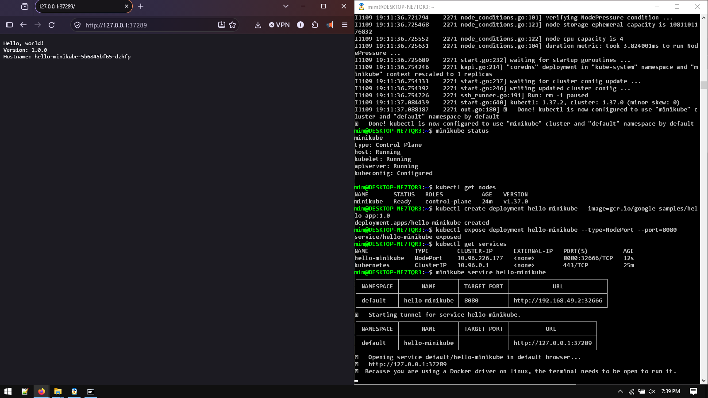
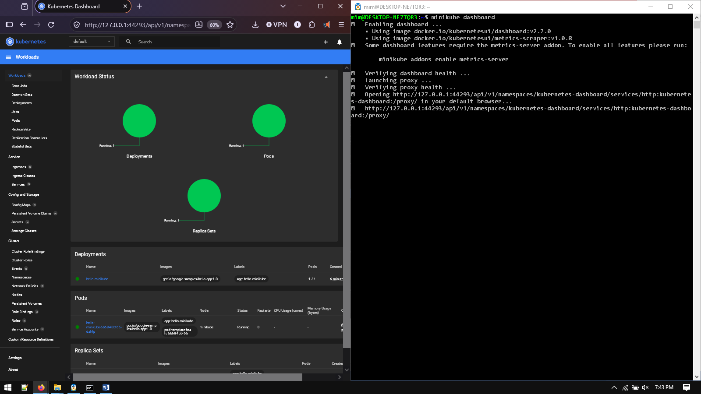
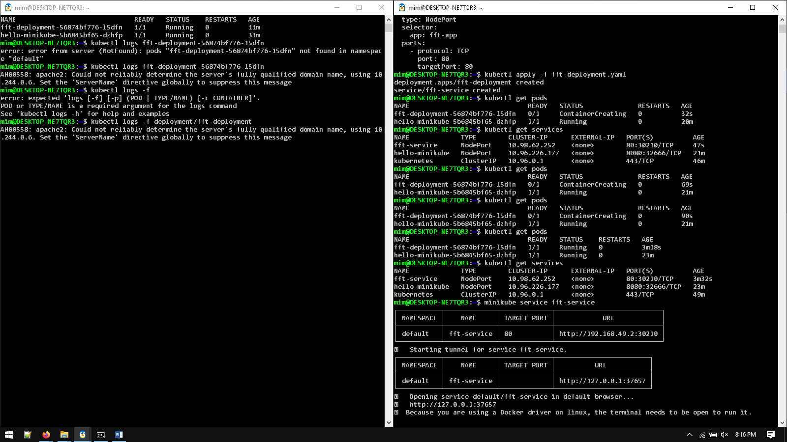
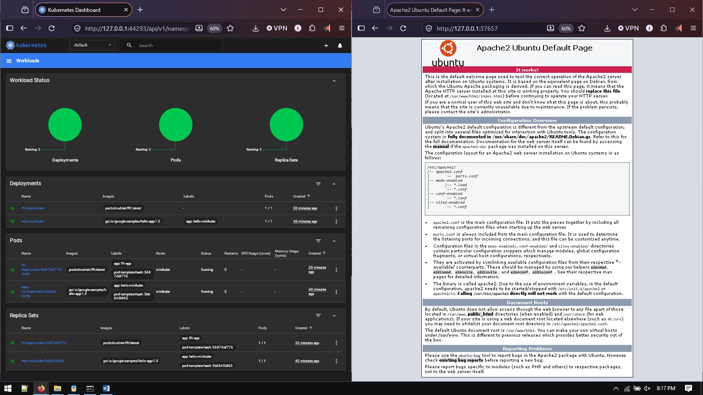
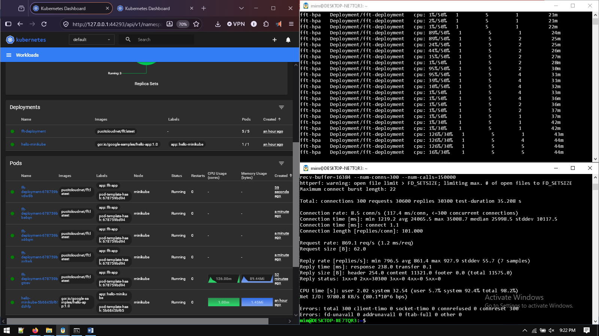
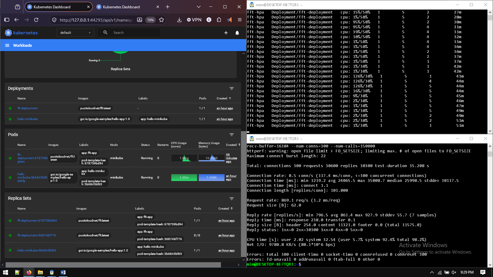
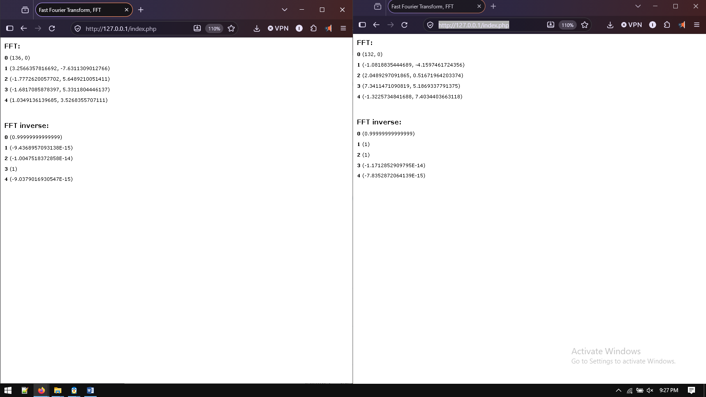

# FFT Function Deployment & Autoscaling over Kubernetes (Minikube)


A comprehensive implementation of containerized Fast Fourier Transform (FFT) web application deployment, service load balancing, and dynamic Horizontal Pod Autoscaling (HPA) using **Kubernetes** and **Minikube** inside a WSL2 Ubuntu environment.

---

## 📋 Table of Contents
- [Project Overview](#-project-overview)
- [Architecture & Workflow](#-architecture--workflow)
- [Repository Structure](#-repository-structure)
- [Prerequisites](#-prerequisites)
- [Milestone Breakdown](#-milestone-breakdown)
  - [Milestone 01: Kubernetes Installation & Setup](#milestone-01-kubernetes-installation--setup)
  - [Milestone 02: Deploying & Managing Applications](#milestone-02-deploying--managing-applications)
  - [Milestone 03: Scaling & Load Balancing (HPA + httperf)](#milestone-03-scaling--load-balancing-hpa--httperf)
- [Step-by-Step Execution Guide](#-step-by-step-execution-guide)
- [Verification & Screenshots](#-verification--screenshots)
- [Author & Academic Details](#-author--academic-details)

---

## 🚀 Project Overview

The objective of this project is to implement, manage, and evaluate container orchestration and dynamic autoscaling capabilities on Kubernetes:
1. **Cluster Setup**: Provisioning and validating a local Kubernetes cluster using **Minikube** with Docker backend.
2. **Container Deployment**: Deploying the sample Apache/PHP Fast Fourier Transform application (`pucitcloudnet/fft:latest`).
3. **Traffic Distribution**: Exposing the application via a Kubernetes `LoadBalancer` service routed through `minikube tunnel`.
4. **Horizontal Pod Autoscaling (HPA)**: Enforcing CPU resource limits and requests with an HPA controller set to scale dynamically (from 1 up to 5 replicas) under synthetic workload generated by **httperf**.

---

## 🏗 Architecture & Workflow

```
                        +---------------------------------------+
                        |           httperf Client              |
                        | (High-Rate HTTP Traffic Generator)    |
                        +-------------------+-------------------+
                                            |
                                            v  (127.0.0.1:80 / Service IP)
                        +---------------------------------------+
                        |            minikube tunnel            |
                        +-------------------+-------------------+
                                            |
                                            v
                +-------------------------------------------------------+
                |     Kubernetes Service (Type: LoadBalancer)           |
                |               Port: 80 -> TargetPort: 80              |
                +---------------------------+---------------------------+
                                            |  Round-Robin / Load Balancing
                     +----------------------+----------------------+
                     |                                             |
                     v                                             v
        +-------------------------+                   +-------------------------+
        |   Pod: fft-deployment   |  <==== HPA =====> |   Pod: fft-deployment   |
        |  Image: pucitcloudnet/  |  (Target: 50% CPU)|  (Scales 1 to 5 pods)  |
        |        fft:latest       |                   |                         |
        +-------------------------+                   +-------------------------+
```

---

## 📁 Repository Structure

```
.
├── ccproj3/
│   ├── fft-deployment.yaml          # Initial Deployment & NodePort Service manifest
│   ├── fft-hpa-lb.yaml              # Production manifest: Resource limits, LoadBalancer Service, & HPA
│   ├── MSDSF25A007-cc-assgn3.docx   # Comprehensive assignment report with embedded results
│   ├── MSDSF25A007-cc-assgn3.zip    # Submission archive
│   ├── AwesomeScreenshot-*.mp4      # Video walkthrough / demonstration
│   └── revise/
│       ├── chronological_commands_reference.md  # Detailed CLI reference for WSL & Minikube
│       ├── milestones_summary.md                # Summary of milestones and validation checks
│       └── restart_guide.md                     # Quick troubleshooting and restart manual
├── screenshots/
│   ├── 01_minikube_terminal_setup.png           # Cluster initialization & node verification
│   ├── 02_minikube_dashboard.png                # Minikube GUI dashboard overview
│   ├── 03_deployment_pods_services.png          # Running pods and LoadBalancer service
│   ├── 04_fft_application_ui_browser.png        # FFT application accessible in browser
│   ├── 05_hpa_max_replicas_scaling.png          # Autoscaler scaled up to max replicas (5/5)
│   ├── 06_hpa_cooldown_min_replicas.png         # Autoscaler cooldown back to 1 replica
│   └── 07_fft_calculation_results_ui.png        # FFT & IFFT execution output
├── Assignment_3__Deployment_on_Kubernetes_Fall_2026.pdf # Official course assignment prompt
└── README.md                                    # Documentation and setup guide
```

---

## ⚙ Prerequisites

Ensure you have the following installed and configured on your host system:
- **Windows 10/11** with **WSL2** (Ubuntu 22.04 LTS or later)
- **Docker Desktop** (with WSL2 integration enabled)
- **Minikube**: Local Kubernetes engine
- **kubectl**: Kubernetes CLI tool
- **httperf**: Web performance & benchmarking tool (`sudo apt install httperf`)

---

## 📌 Milestone Breakdown

### Milestone 01: Kubernetes Installation & Setup
- Initialized local cluster using `minikube start --driver=docker`.
- Verified cluster readiness using `kubectl get nodes` and `kubectl cluster-info`.
- Activated the web dashboard using `minikube dashboard`.

### Milestone 02: Deploying & Managing Applications
- Authored Kubernetes manifests defining deployment replicas, ports, and container image `pucitcloudnet/fft:latest`.
- Created and exposed the deployment through a Kubernetes service.
- Configured `minikube tunnel` to route local requests to the external LoadBalancer IP.
- Verified live web interface of the FFT application via browser.

### Milestone 03: Scaling & Load Balancing (HPA + httperf)
- Configured Pod CPU requests (`100m`) and limits (`250m`).
- Created a `HorizontalPodAutoscaler` (HPA v2) resource targeting 50% average CPU utilization, bounded between 1 (min) and 5 (max) replicas.
- Generated stress traffic using `httperf`:
  ```bash
  httperf --server 127.0.0.1 --port 80 --uri /index.php --num-conns 300 --rate 1500
  ```
- Monitored real-time auto-scaling (`kubectl get hpa --watch`) scaling out to **5 replicas** under peak load and cooling down gracefully to **1 replica** post-load.

---

## 🛠 Step-by-Step Execution Guide

### 1. Start Cluster & Network Tunnel
```bash
# Start Minikube cluster
minikube start

# In a separate terminal session, launch the network tunnel for LoadBalancer routing:
minikube tunnel
```

### 2. Deploy Application & Configure HPA
Apply the unified configuration containing deployment with resource constraints, LoadBalancer service, and HPA:
```bash
kubectl apply -f ccproj3/fft-hpa-lb.yaml
```

Verify that the deployment, service, and HPA are initialized:
```bash
kubectl get deployments
kubectl get svc
kubectl get hpa
```

### 3. Access Application
Open your browser and navigate to:
```
http://127.0.0.1/
```
You can execute Fast Fourier Transform (FFT) and Inverse Fast Fourier Transform (IFFT) computations through the interactive web UI.

### 4. Run Load Test & Observe Autoscaling
In another terminal, trigger the load generator:
```bash
httperf --server 127.0.0.1 --port 80 --uri /index.php --num-conns 300 --rate 1500
```

Watch the autoscaler react in real time:
```bash
kubectl get hpa --watch
```

---

## 📸 Verification & Screenshots

### Milestone 1: Cluster Initialization
| Minikube Setup & Node Validation | Minikube Web Dashboard |
| :---: | :---: |
|  |  |

### Milestone 2: Deployment & Service Expose
| Deployment & Services Status | FFT Web UI in Browser |
| :---: | :---: |
|  |  |

### Milestone 3: Autoscaling (HPA) & Load Testing
| Peak Load: Scaled to 5 Replicas (MAX) | Post-Load Cooldown: 1 Replica (MIN) |
| :---: | :---: |
|  |  |

### Functional Verification
| Fast Fourier Transform (FFT) Calculation Output |
| :---: |
|  |

---

## 👨‍💻 Author & Academic Details
- **Course**: CS/DS 584 - Cloud Computing (Fall 2026)
- **Institution**: Faculty of Computing and Information Technology (FCIT), University of the Punjab
- **Instructor**: Dr. Muhammad Abdullah
- **Student ID**: MSDSF25A007
